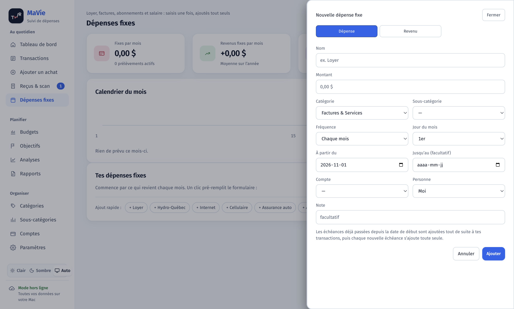
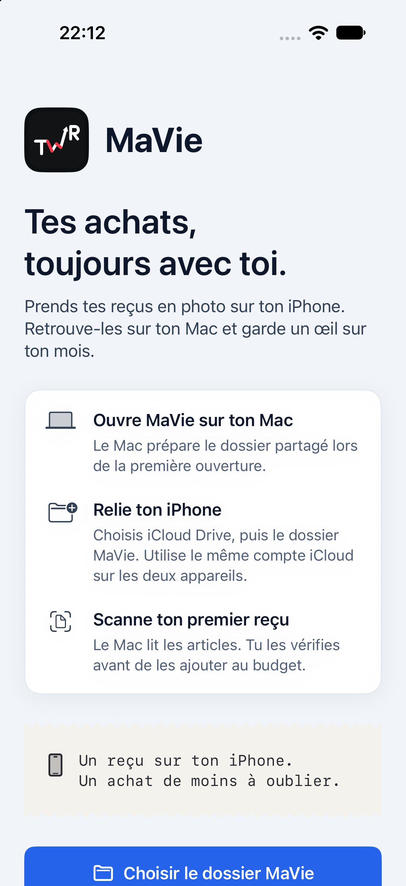
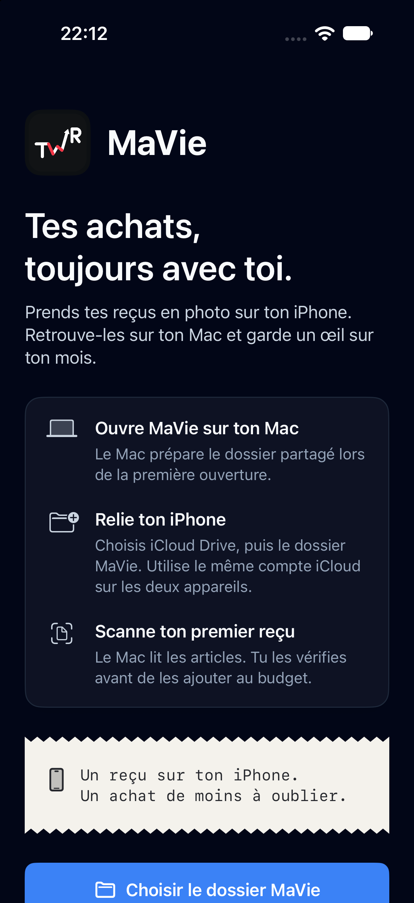

<div align="center">


# MaVie

**Les finances du foyer, sur ton Mac et ton iPhone.**
Prends un reçu en photo, l'IA lit chaque article et le range dans la bonne catégorie.

   

</div>

<p align="center"></p>

## Ce que fait MaVie

- **Reçus lus par l'IA** : chaque article est classé (Viande, Légumes, Essence…), puis tu vérifies et confirmes.
- **iPhone → Mac via iCloud** : tu prends la photo sur le téléphone, le Mac la lit tout seul.
- **Dépenses sans reçu** : « 20 $ d'essence » en deux touches.
- **Dépenses fixes** : loyer, salaire et abonnements s'ajoutent tout seuls à leur date.
- **Résumé du mois** : ce qu'il te reste, ton rythme de dépense, les prochaines échéances.
- **Catégories, sous-catégories, budgets, objectifs, analyses, rapports CSV.**
- **Mode clair, sombre ou automatique**, sur Mac comme sur iPhone.
- **Tes données restent sur ton Mac.**

## Sur Mac

| Clair | Sombre |
|---|---|
|  |  |
|  |  |

## Sur iPhone

<p align="center">
  
  &nbsp;&nbsp;
  
</p>

Trois onglets : **Mon mois** (le suivi), **Ajouter** (photo ou saisie rapide) et **Envois** (ce que le Mac a lu).

## Comment ça marche

```
iPhone ──photo──▶ iCloud Drive/MaVie ──▶ Mac (MaVie) ──▶ IA (gpt-reserve, Gemini en secours)
   ▲                                          │
   └──────── résumé du mois ◀─────────────────┘
```

## Installer

**Mac** : ouvre `MaVie-1.0.0-arm64.dmg` et glisse MaVie dans Applications. Au premier lancement, fais clic droit puis Ouvrir (l'app n'est pas notariée).

**iPhone** : ouvre `ios/` dans Xcode, choisis ton Apple ID, puis Run. Avec un compte gratuit, l'app est à réinstaller tous les 7 jours (détails dans `ios/README.md`).

## Développement

```bash
npm install
npm run dev                                    # http://localhost:3000
bash scripts/build-mac.sh                      # construit le .dmg
cd ios && bash build-ipa.sh                    # construit le .ipa
```

Stack : Next.js 16, React 19, SQLite (Drizzle), Electron, SwiftUI.
Système de design : `design-system/mavie/MASTER.md`.
