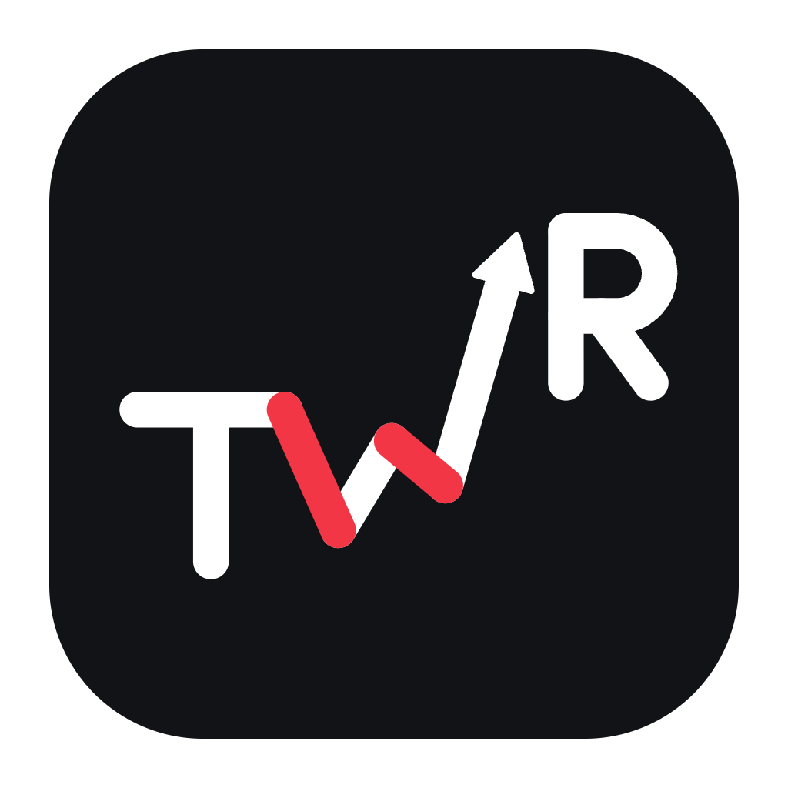

<div align="center">
  

  # MaVie

  **Tes achats sur iPhone. Ton budget au clair sur Mac.**

  Prends un reçu en photo, retrouve chaque article dans la bonne catégorie et garde le fil de tes finances au même endroit.

  
  
  
</div>

<br />


<p align="center"><em>Un mois entier en un coup d’œil : revenus, dépenses, catégories et reçus à vérifier.</em></p>

## Ce que tu peux faire

| Au quotidien | Pour voir plus loin |
| :--- | :--- |
| **Photographier un reçu** sur iPhone ou l’ajouter sur Mac, puis vérifier les articles extraits par l’IA avant l’import. | **Suivre ton mois** : solde disponible, rythme des dépenses et évolution dans le temps. |
| **Saisir un achat rapidement**, même sans reçu. | **Organiser** catégories, sous-catégories, comptes et personnes du foyer. |
| **Retrouver les reçus** et leurs statuts depuis l’iPhone. | **Prévoir** dépenses et revenus récurrents, budgets et objectifs. |
| **Passer du mode clair au mode sombre** sur les deux appareils. | **Explorer** les analyses et exporter les rapports en CSV. |

## L’app en images

### Mac : un tableau de bord qui suit ton rythme

Le tableau de bord rassemble le reste à dépenser, la répartition par catégorie et les derniers reçus. Il existe aussi en mode sombre.

<p align="center">
  <a href="docs/screenshots/mac-accueil-sombre.png"></a>
</p>

| Catégories et sous-catégories | Dépenses fixes |
| :---: | :---: |
| <a href="docs/screenshots/mac-categories.png"></a> | <a href="docs/screenshots/mac-depenses-fixes.png"></a> |
| Classe tes achats comme tu vis. | Ajoute une fois le loyer, un abonnement ou un revenu récurrent. |

### iPhone : les reçus à portée de main

L’iPhone sert à photographier les reçus, saisir des dépenses et consulter le mois. Ces captures montrent le **premier démarrage**, quand on relie l’app au dossier MaVie dans iCloud Drive.

<p align="center">
  
  &nbsp;&nbsp;&nbsp;
  
</p>

## Du reçu au budget


Le Mac conserve la base de données SQLite localement. Le dossier iCloud Drive transporte les reçus et les informations de suivi entre les appareils. Pour lire un reçu, MaVie utilise le lecteur d’IA configuré sur le Mac : **gpt-reserve via Codex**, puis **Gemini en secours** si une clé est disponible. Le contenu du reçu peut donc être transmis au service d’IA choisi. Tu gardes la validation finale avant d’ajouter les articles à tes transactions.

## Installer MaVie

### Sur Mac

MaVie nécessite un **Mac Apple Silicon sous macOS 12 ou plus récent**. Construis le fichier DMG avec les étapes ci-dessous, puis ouvre `MaVie-1.0.0-arm64.dmg` et glisse l’app dans **Applications**. La signature est ad hoc, sans notarisation Apple : au premier lancement, un clic droit puis **Ouvrir** peut être nécessaire.

### Sur iPhone

L’app nécessite **iOS 17 ou plus récent**. Dans `ios/`, installe XcodeGen (`brew install xcodegen`), lance `xcodegen generate`, puis ouvre `MaVie.xcodeproj` dans Xcode. Choisis ton équipe de signature et lance l’app sur l’iPhone. Au premier démarrage, sélectionne le dossier `MaVie` dans iCloud Drive avec le même compte iCloud que sur le Mac. Le [guide iPhone](ios/README.md) détaille aussi la construction de l’IPA et les autres méthodes d’installation.

## Développer

**Pré-requis :** Node.js et npm pour le Mac ; Xcode et XcodeGen pour l’iPhone.

```bash
git clone https://github.com/rayanerrr/mavie-finances.git
cd mavie-finances
npm install
npm run db:seed
npm run dev
```

Ouvre [http://localhost:3000](http://localhost:3000). Pour remplir l’app avec des exemples comme sur les captures, lance `npm run db:demo` après `db:seed`.

Pour lancer la fenêtre Mac en développement, garde le serveur Next.js ouvert dans un premier terminal, puis exécute `npm run desktop:dev` dans un second. Pour construire le DMG :

```bash
npm run desktop:build
# Résultat : /tmp/mavie-build/dist/MaVie-1.0.0-arm64.dmg
```

Pour l’iPhone, suis le [guide de construction iOS](ios/README.md) (`brew install xcodegen`, puis `cd ios && ./build-ipa.sh`).

**Stack :** Next.js 16, React 19, Electron, SQLite avec Drizzle, SwiftUI. Le [système de design](design-system/mavie/MASTER.md) et les [notes de conception](docs/DESIGN.md) documentent l’interface.

---

<p align="center">Conçu pour voir où va ton argent, sans perdre le fil de tes achats.</p>
